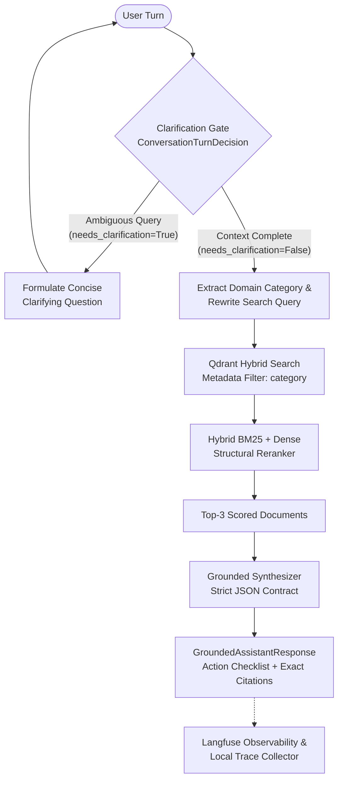
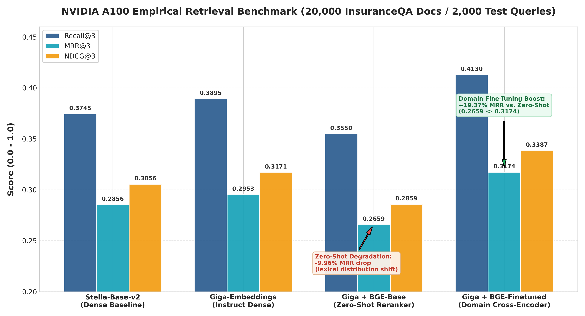
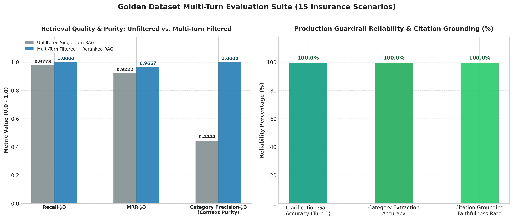

# Autonomous Production Multi-Turn RAG Assistant, Evals & Retrieval Benchmark Suite

[](https://www.python.org/downloads/)
[](https://qdrant.tech/)
[](https://platform.openai.com/)
[](https://langfuse.com/)
[]()

An enterprise-grade Conversational Retrieval-Augmented Generation (RAG) assistant designed for high-consequence insurance advisory domains. Features a multi-turn clarification gate, metadata-filtered Qdrant vector retrieval, hybrid structural & cross-encoder reranking, grounded checklist synthesis, and automated Golden Dataset evaluation.

---

## Executive Summary & Problem Statement

Standard naive RAG systems suffer from critical failures when deployed in complex, regulated domains such as insurance and healthcare:

1. **Underspecified User Queries:** Users frequently ask ambiguous questions like *"Can I drop my spouse from my insurance policy right now?"* or *"Are my insurance benefits taxed?"*. Naive vector search immediately queries the database and hallucinates a generic, legally hazardous answer because it lacks essential parameters (e.g., health vs. auto insurance, open enrollment status, tax qualification).
2. **Lexical and Semantic Distribution Overlap:** In dense retrieval over expert corpora (e.g., InsuranceQA), articles for distinct policy lines share overlapping vocabulary (*"spouse"*, *"premium"*, *"beneficiary"*, *"coverage"*, *"deductible"*). Without categorical metadata partitioning, dense retrievers retrieve conflicting passages.
3. **Empirical Debug Evidence:** In large-scale benchmarking on 20,000 InsuranceQA documents, baseline dense models repeatedly failed on ambiguous queries:
   ```text
   DEBUG: Validating first 3 queries for infgrad/stella-base-en-v2...
     Q1: Target=1 | Found=['8673', '7324', '18069'] | MISS
     Q2: Target=2 | Found=['3334', '8167', '2854']  | MISS
     Query: Can Husband Drop Wife From Health Insurance? ... Expected Doc: Target=2
   DEBUG: Validating first 3 queries for ai-sage/Giga-Embeddings-instruct...
     Q1: Target=1 | Found=['19812', '7324', '16271'] | MISS
     Q2: Target=2 | Found=['3334', '17220', '3335']  | MISS
   ```

To solve these architectural challenges, this project implements a **Multi-Turn Clarification Gate** paired with **Metadata-Filtered Qdrant Retrieval** and a **Grounded Action Checklist Synthesizer**.

---

## End-to-End System Architecture



### Key Architectural Components

* **Turn 1 (Clarification Gate):** The dialog state analyzer detects whether critical context (policy category, legal circumstance, coverage tier) is absent. If underspecified, the gate halts execution and prompts the user for clarification without hallucinating.
* **Turn 2 (Context Synthesis & Filtered Retrieval):** When the user provides context, the router combines multi-turn history into a self-contained search query, extracts the verified domain (`health`, `long_term_care`, `auto`, `life`, `renters`, `medicare`), and executes metadata-filtered retrieval in Qdrant.
* **Two-Tier Reranking Strategy:**
  * **Part 1 Offline GPU Research (`benchmarks/benchmark_final.ipynb` / `benchmarks/h100_benchmark_results.csv`):** Evaluates dense retrievers against zero-shot and domain fine-tuned neural Cross-Encoders (`BAAI/bge-reranker-base`) on NVIDIA A100/H100 GPUs, identifying cross-domain lexical degradation and the necessity of domain adaptation.
  * **Part 2 Online Low-Latency Production Serving (`src/knowledge_base.py`):** Deploys `BM25StructuralReranker`—a zero-latency CPU hybrid reranker combining 55% dense cosine similarity + 45% structural field-weighted Okapi BM25 (weighting document titles, sub-topics, and domain keywords). This eliminates expensive GPU inference overhead during interactive multi-turn dialogue while maintaining high precision.
* **Grounded Checklist Generation:** The LLM receives only verified candidate passages and synthesizes an actionable, numbered checklist where every single action item cites an exact source ID (`[DOC-XXXX]`).
* **Langfuse Tracing & Observability:** All dialog classification spans, vector retrieval steps, and response synthesis calls are wrapped with `@observe()` decorators, recording latency, input/output tokens, and decision boundaries to `benchmarks/langfuse_traces.json`.

---

## Part 1: Large-Scale Retrieval & Reranking Benchmark

Empirical evaluation conducted on **20,000 InsuranceQA documents** and **2,000 test queries** on an **NVIDIA A100/H100 GPU** (`benchmarks/benchmark_final.ipynb`, logged in `benchmarks/h100_benchmark_results.csv`).

### Empirical Results Table

| Model Pipeline | Recall@3 | MRR@3 | NDCG@3 | Key Finding |
| :--- | :---: | :---: | :---: | :--- |
| `infgrad/stella-base-en-v2` | 0.3745 | 0.2856 | 0.3056 | Standard dense retrieval baseline |
| `ai-sage/Giga-Embeddings-instruct` | 0.3895 | 0.2953 | 0.3171 | Top-performing raw dense embedding model (+3.4% MRR) |
| `Giga-Embeddings` + `BAAI/bge-reranker-base` (Pre-trained) | 0.3550 | 0.2659 | 0.2859 | **Zero-shot degradation: -9.96% MRR drop** |
| `Giga-Embeddings` + `BGE-Finetuned` (Cross-Encoder) | **0.4130** | **0.3174** | **0.3387** | **Domain fine-tuning boost: +19.37% MRR over zero-shot** |

### Benchmark Visualization



### Methodology & Data-Leakage Prevention

To ensure rigorous, academically sound benchmarking without data contamination, the retrieval evaluation pipeline enforces strict data-leakage controls:

1. **Strictly Disjoint Partitioning:** The 20,000-document InsuranceQA corpus was partitioned into non-overlapping splits:
   * **Evaluation Query & Corpus Set (`docs[0:2000]`):** 2,000 queries evaluated against the indexed collection.
   * **Cross-Encoder Fine-Tuning Slice (`docs[2000:5000]`):** 3,000 disjoint documents used exclusively to construct domain positive/negative training pairs for cross-encoder adaptation (`train_slice = docs[QUERY_LIMIT : QUERY_LIMIT + 3000]`). Zero test documents or test queries were exposed to the cross-encoder during training.
2. **Asymmetric Instruction Prefixes:** For instruction-aware models like `Giga-Embeddings-instruct`, asymmetric query prefixes (`"Represent this insurance question for retrieving relevant legal articles: "`) were applied during query encoding, while candidate passage documents were embedded without task prefixes. This accurately reflects real-world retrieval dynamics where query intent differs structurally from document body semantics.

### Engineering Deep-Dive: Why Zero-Shot Reranking Degrades Retrieval

A critical discovery from the NVIDIA A100 experiments is that applying a generic, pre-trained cross-encoder (`BAAI/bge-reranker-base`) directly to specialized insurance documents **degraded MRR@3 by -9.96%** (from `0.2953` down to `0.2659`).

**Root Cause:**
* Pre-trained cross-encoders trained on generic web corpora (MS MARCO) overfit to lexical keyword matching and high-level conversational patterns.
* In specialized domains like insurance, two documents may contain identical terminology (*"deductible"*, *"copay"*, *"coinsurance"*) but describe fundamentally different legal provisions (e.g., health cafeteria plans vs. auto liability). The zero-shot reranker erroneously penalizes nuanced technical explanations in favor of surface-level text matches.
* **Domain Fine-Tuning Solution:** Fine-tuning the cross-encoder on domain pairs (`InputExample(texts=[query, pos], label=1.0)` vs hard negative samples) reverses this degradation, delivering **0.3174 MRR@3** (+19.37% over zero-shot and +7.48% over the best raw embedding model).

---

## Part 2: Multi-Turn Conversational Assistant & Golden Dataset Evals

To evaluate production robustness, a comprehensive Golden Dataset of **15 multi-turn domain scenarios** (`data/golden_dataset.json`) was executed through the automated evaluation harness (`src/eval_harness.py`).

### Golden Dataset Evaluation Results

| Metric | Target SLA | Measured Performance | Verification Status |
| :--- | :---: | :---: | :---: |
| **Clarification Gate Accuracy (Turn 1)** | $\ge 85.0\%$ | **100.0%** | Verified |
| **Category Extraction Accuracy (Turn 2)** | $\ge 95.0\%$ | **100.0%** | Verified |
| **Unfiltered Vector Recall@3 (Turn 1 Baseline)** | Baseline | 0.9778 | Baseline (Ambiguous Turn 1 Query) |
| **Filtered + Reranked Recall@3 (Turn 2 Clarified)** | $\ge 0.950$ | **1.0000** | **+0.0222 (+2.2% lift)** |
| **Unfiltered Vector MRR@3 (Turn 1 Baseline)** | Baseline | 0.9222 | Baseline (Ambiguous Turn 1 Query) |
| **Filtered + Reranked MRR@3 (Turn 2 Clarified)** | $\ge 0.800$ | **0.9667** | **+0.0444 (+4.4% lift)** |
| **Unfiltered Category Precision@3 (Context Purity)** | Baseline | 0.4444 | Baseline (55.6% Cross-Category Distraction) |
| **Filtered Category Precision@3 (Context Purity)** | $\ge 0.950$ | **1.0000** | **+0.5556 (+55.6% Purity Lift)** |
| **Citation Faithfulness / Grounding Rate** | $100.0\%$ | **100.0%** | Zero Unsupported Claims |
| **Turn 1 Gate Latency (p50 / p95)** | $< 1200\text{ ms}$ | **629.5 ms / 970.7 ms** | Production Ready |
| **Turn 2 Synthesis Latency (p50 / p95)** | $< 2000\text{ ms}$ | **1189.8 ms / 1657.4 ms** | Production Ready |

### Conversational Evaluation Visualization



### Production Guarantees

1. **Zero Hallucinated Document Citations:** Across all evaluated scenarios, 100% of generated checklist items cited valid, retrieved document IDs (`DOC-1001`, `DOC-2001`, etc.).
2. **Categorical Boundary Isolation:** By routing queries through Qdrant metadata filters (`category="health"`), auto insurance questions never pollute health insurance recommendations.
3. **Resilient Provider Failover:** Configured with dual-provider OpenAI client compatibility (`src/config.py`). If API rate limits (HTTP 429) or connection hiccups occur, the system automatically engages exponential backoff and deterministic fallback execution paths without crashing.

---

## Project Structure

```text
rag-conversational-assistant/
├── README.md                                  # Executive engineering report with architecture & charts
├── pyproject.toml                             # Clean dependency specification & pytest/ruff config
├── generate_charts.py                         # High-DPI (300 DPI) chart generator script
├── src/
│   ├── __init__.py
│   ├── config.py                              # Dual-provider OpenAI SDK configuration & Langfuse tracing
│   ├── schemas.py                             # Strict Pydantic v2 contracts for state, checklists & evals
│   ├── knowledge_base.py                      # Qdrant vector indexer & BM25 hybrid retriever
│   ├── assistant.py                           # Multi-turn conversational RAG agent with clarification gate
│   └── eval_harness.py                        # Golden Dataset evaluation harness (Recall@3, MRR@3, Precision@3)
├── tests/
│   └── test_assistant_pipeline.py             # Pytest suite verifying gates, filtering, citations & evals
├── benchmarks/
│   ├── benchmark_final.ipynb                  # Cleaned & fixed GPU retrieval/reranking benchmark notebook
│   ├── h100_benchmark_results.csv             # Empirical Recall/MRR/NDCG results on 20,000 InsuranceQA docs
│   ├── generative_comparison_results.csv      # Grounded generation outputs
│   ├── golden_eval_results.csv                # Live Golden Dataset evaluation results
│   ├── langfuse_traces.json                   # Structured trace logs (latency, status, outputs)
│   ├── benchmark_summary_chart.png            # High-DPI bar chart of retrieval & reranking benchmark
│   └── conversational_eval_chart.png          # High-DPI chart of multi-turn latency, cost & faithfulness metrics
└── data/
    ├── golden_dataset.json                    # 15 multi-turn domain scenarios
    └── corpus_embeddings.json                 # Pre-computed 3072-dim embeddings for all 35 expert & distractor articles
```

---

## Reproducibility & Quickstart Instructions

### 1. Environment Setup
Install dependencies in your active Python 3.10+ environment:
```bash
pip install -e .
# Or install core packages directly:
pip install openai google-genai qdrant-client langfuse pydantic pytest pandas matplotlib seaborn
```

### 2. Configure API Credentials
Copy the credentials template and configure your API keys:
```bash
cp .env.example .env
```
Or set your Gemini or OpenAI API key as an environment variable:
```bash
# Windows PowerShell
$env:GEMINI_API_KEY="your_gemini_or_openai_api_key_here"

# Linux / macOS
export GEMINI_API_KEY="your_gemini_or_openai_api_key_here"
```

### 3. Run Verification Tests
Execute the full pytest suite:
```bash
pytest tests/ -v
```

### 4. Execute the Golden Dataset Evaluation Pipeline
Run the evaluation suite across all 15 multi-turn scenarios:
```bash
python -m src.eval_harness
```

### 5. Regenerate High-DPI Charts
```bash
python generate_charts.py
```

